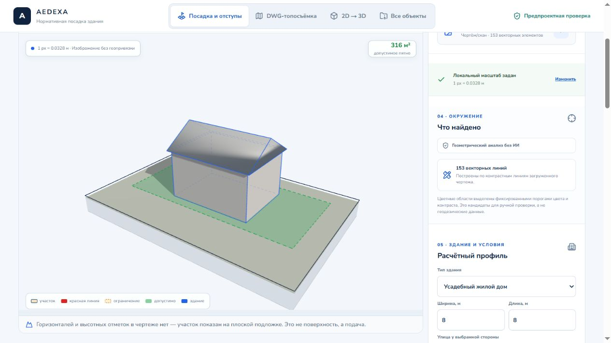
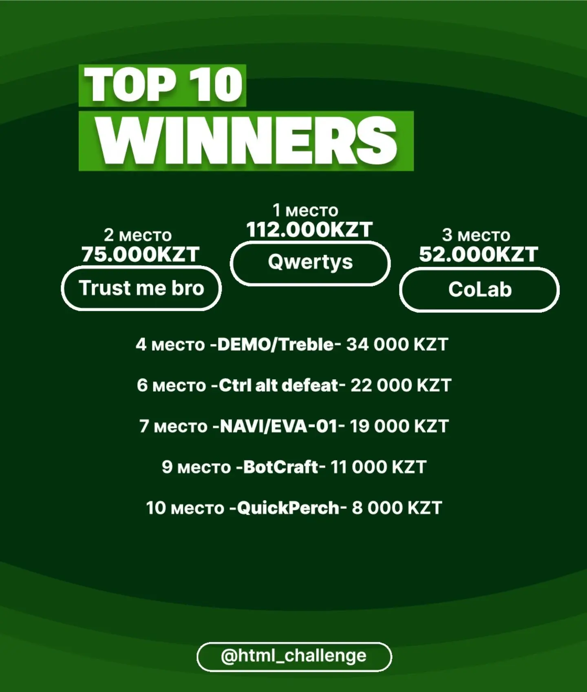

# AEDEXA
### From a site drawing to a model you can question.

**QwertyS · HTML Challenge 2026 — first place · AI Builders Hackathon submission**

AEDEXA makes early site-planning decisions inspectable: read a CAD drawing,
identify the site, build terrain, test placement and trace the result to its rule.
This public repository contains the **hackathon web edition** and its original
development history. It pairs the implemented product with the competition record.

[Open the hackathon app](https://aedexa.site/) ·
[Watch the submitted demo](https://www.youtube.com/watch?v=wwHJ0La7rXE) ·
[Devpost submission](https://devpost.com/software/aedexa) ·
[Full visual case study](https://github.com/pip00sya/aedexa-showcase)


## Watch the submitted demo

[](https://www.youtube.com/watch?v=wwHJ0La7rXE)

**[▶ Watch AEDEXA — Devpost AI Builders hackathon pitch and demo](https://www.youtube.com/watch?v=wwHJ0La7rXE)**

The original recording is hosted on Nurkhan Aimukatov's YouTube channel.
Click the preview to watch the hackathon edition. The animation below is the
landing-page identity; it is separate from the submitted product demo.

### The tetrahedron is part of the product's identity

The landing page introduces AEDEXA through a rotating **3D portal tetrahedron**.
Its faces open onto architectural scenes, connecting the geometric mark to the
product's movement between drawings, site geometry and spatial models. The
wordmark, topographic background and alternating drawing-led sections carry
that same visual language into the rest of the page.


*The original 26-second landing animation, converted to GIF for GitHub.
[Open the retained WebM animation](docs/portfolio/media/tetra.webm).*

<details><summary>See the full hackathon landing page</summary>


*Captured from the public hackathon host on 12 October 2026. The statistics
are the project's published checks, not a newly performed independent benchmark.*

</details>


The browser parses the drawing and performs geometry, terrain and export work.
Optional server-side AI helps interpret CAD semantics and reconstruct a building.
When information is missing, the result is labelled `MISSING_DATA` or
`EXPERT_REVIEW` rather than filled in with an invented answer.



## Competition record

The HTML Challenge organizer's [winner announcement](https://www.instagram.com/html_challenge/p/DddbiW2jNRV/?img_index=2)
names **Qwertys in first place**. The [event listing](https://hackathon.kz/event.html?slug=html-challenge-2026)
and [supporting source record](docs/portfolio/HACKATHON.md) retain the context and
distinguish scheduled dates from the later result announcement.



AEDEXA was also submitted to the [AI Builders Hackathon](https://ai-builders-hackathon-2026.devpost.com/)
on Devpost; it did not receive a prize there. All screenshots, the hosted app and
the linked video on this page refer to the hackathon edition. Media provenance is
recorded [here](docs/portfolio/MEDIA.md).

### Beyond the hackathon edition

A separate, non-public expanded version exists. This subsection is reserved for
the team's approved description of that work. Its implementation and media are
not included in this repository.

## Working with the source

How the app is built is described in the [architecture notes](docs/ARCHITECTURE.md), and
deployment in the [deployment guide](docs/DEPLOY.md).

A browser platform for early-stage design: a site drawing becomes a model you can
check — boundary, utility protection zones, buildable area, 3D terrain, and
buildings with setback checks. Everything is computed on the user's device; the
server is used for 2D → 3D reconstruction and for AI analysis of CAD labels and groups when the user asks for it.

The core principle: every number has a source. Every result carries a status —
`PASS`, `FAIL`, `MISSING_DATA`, or `EXPERT_REVIEW` — and a link to the rule it
came from. If the drawing does not contain the data, the platform says so plainly
instead of filling in a typical value.

## Modes

| Mode | What it does |
|---|---|
| **Placement & setbacks** | DWG, DXF, a plan image, or a site on the map → drawing type → boundary → regulatory zones and surroundings → honest buildable area → 3D site → buildings with sanitary clearances and earthworks → site layout sheet (SPOZU) in DXF |
| **DWG topo survey** | TIN terrain from spot elevations and contour lines, object classification, driveway surfaces, 2D drawing and 3D scene, DAE and DXF export |
| **2D → 3D** | Building reconstruction from a drawing: sheet audit, parametric recipe, solver, independent check; available when a model key is configured |
| **All projects** | In-browser archive of results with previews and reopening |

Four ready-made sites in `public/demo/` are read by the same parser as a user's
file: the demo is the program doing real work.

Before any calculation, the drawing type is detected from layer names: topographic survey, site plan,
building set, interior, or detail. Placement runs only on the first two — a museum
section or a sheet of elevations does not become a site. The decision and its reasons
are shown on screen, and the role of any layer can be corrected by hand.

## Getting started

```bash
npm install
npm run dev
```

Environment variables are described in `.env.example`. Without keys the app works
for geometry calculations, maps, topography, and export. A key is needed for AI reconstruction and the optional AI checks of CAD drawings.

Sign-in, sign-up, and project sync run on Cloudflare D1.
The local database sets itself up: `npm run dev` applies the migrations from
`migrations/` before starting. `npm run db:local` does the same on its own. The database
file lives in `.wrangler/state` and is not committed to git.

For Featherless you can set `FEATHERLESS_API_KEY_2`: when the model is temporarily
busy, the request tries the backup account. Access, billing, and quota errors
stop the request; switching keys does not apply to them. There are at most five
attempts in total, with a pause after cycling through the available accounts.

If the full building recipe does not fit into a response even after raising the limit,
2D → 3D splits it by volume: first the overall plan, then the parameters of each volume.
Units and the building center are shared; an incomplete recipe is never passed off as a finished result.
This path takes more requests and more time. The model check starts
after assembly, with the full time budget.

AI checks of CAD drawings are started manually. Large dictionaries are read in sequential
batches; the browser receives progress stages as NDJSON. The API still returns a plain JSON response
to clients that do not send the `Accept: application/x-ndjson` header.

Checks:

```bash
npm run lint
npm run typecheck
npm test
npm run check:drawings -- fixtures/drawings
```

`npm test` builds the production bundle and runs the unit tests: DWG and
DXF parsing, the drawing type detector, layer roles, TIN, geometry, utility and
surroundings zones, placement, site terrain, buildings, the sheet, sun, export, and page
rendering.

`check:drawings` runs the pipeline over a folder of real drawings and prints a
summary: what opened, what was recognized as a site, and why.

## Deployment

The `vinext` build targets Cloudflare Workers. Sign in once and deploy:

```bash
npx wrangler login
npm run deploy
```

Keys for 2D → 3D mode are set as Worker secrets:

```bash
npx wrangler secret put FEATHERLESS_API_KEY
```

### Database

Accounts and projects live in Cloudflare D1. The database is created once:

```bash
npx wrangler d1 create aedexa
```

The command prints a `database_id` — put it into `wrangler.jsonc` in place of
the current one. Then apply the schema to the database:

```bash
npm run db:remote
```

The order matters: first the database and its ID, then `npm run deploy`.
The schema changes only through a new file in `migrations/` — editing a file that
was already applied will not be re-run on the production database.

Post-deployment check: `curl https://your-site/api/auth` returns
`{"account":null}`. A response with `NO_DATABASE` means the `DB` binding did not
reach the Worker, and sign-in will not work.

## Structure

```
app/
  api/            language model routes: cad-groups, cad-semantics, reconstruct
  components/     AedexaApp (placement), PlacementScene (3D site),
                  CadProcessingView and CadViewport (topo survey), MapSourceView,
                  ReconstructionWorkspace, ArchiveWorkspace
  lib/
    placement/    placement: drawing type, layer roles, setback and buildable-area engine,
                  DXF, terrain, buildings, surroundings, sheet, map
    cad/          DWG pipeline: parsing, classification, TIN, roads, export
    norms/        building code registry with a source record for every rule
    ai/           shared client for model providers
    geometry/     2D primitives
docs/             architecture and deployment
public/demo/      ready-made sites in DXF
tests/            automated tests
```

## Libraries

- [`@mlightcad/libredwg-web`](https://github.com/mlightcad/libredwg-web) — DWG reading (GPL-3.0)
- [`three`](https://github.com/mrdoob/three.js) — 3D scene (MIT)
- [`delaunator`](https://github.com/mapbox/delaunator) — terrain triangulation (ISC)
- [`polygon-clipping`](https://github.com/mfogel/polygon-clipping) — polygon operations (MIT)
- [`leaflet`](https://github.com/Leaflet/Leaflet) — map (BSD-2-Clause)
- [`react`](https://github.com/react/react) — interface (MIT)
- [`lucide-react`](https://github.com/lucide-icons/lucide) — icons (ISC)

## License

GPL-3.0, see [LICENSE](LICENSE). Chosen because the DWG reader,
`@mlightcad/libredwg-web`, is GPL-3.0 and ships to the browser as part of
this app.

## Limitations

Regulatory values are typical and are marked as needing a check against the current
edition. The red line, cadastral boundary, and protection zones require official
sources; image recognition does not replace them. The app does not produce construction
documents and does not replace CAD or BIM systems.

## Joint development and project copy

**QwertyS** — jointly developed by [Shakhnazar Akhmer / Eye172](https://github.com/Eye172)
and [Nurkhan Aimukatov / pip00sya](https://github.com/pip00sya), with equal roles as
Full-stack Engineers, Software Engineers and AI Engineers. Shakhnazar also works as an ML Engineer.

The original development history and code are preserved in
[pip00sya/aedexa-hackathon](https://github.com/pip00sya/aedexa-hackathon).
Full-history project copy and migration materials:
[Eye172/aedexa-1](https://github.com/Eye172/aedexa-1).
